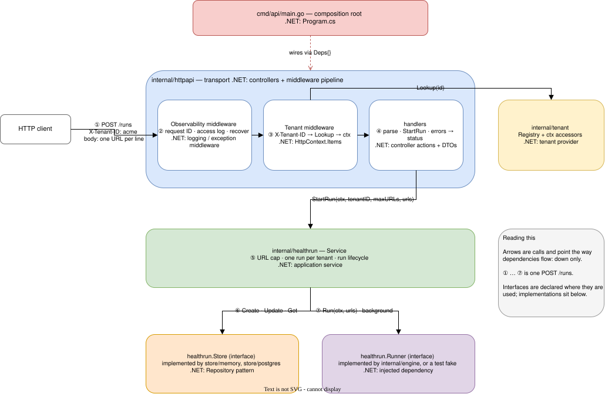

# Architecture

The diagram is the source of truth. Double-click `architecture.drawio.svg` in VS Code (draw.io
extension) to edit it; saving re-renders it here. Each box names its .NET equivalent.

## The four roles

| ASP.NET name | Here | Does |
|---|---|---|
| Controller + middleware | `internal/httpapi` | HTTP in, HTTP out. Parse, validate shape, map errors to status codes. |
| Service | `healthrun.Service` | The rules: URL cap, one run per tenant, run lifecycle. Knows nothing of HTTP. |
| Repository | `healthrun.Store` (interface) | Persist and fetch runs. `store/memory` now, `store/postgres` in Phase 3. |
| Injected dependency | `healthrun.Runner` (interface) | "Summarise these URLs." `internal/engine` is the only real implementation. |

`internal/tenant` is not a layer. Middleware uses it to answer "who is this request for?"; the
service receives the answer as plain arguments.

## Why each boundary exists

- **Service below handler.** The rules are about runs, not HTTP. A CLI or a second front end
  reuses them unchanged.
- **`Store` is an interface.** Phase 3 swaps the map for Postgres and the service must not
  change. Declared by the consumer, satisfied by packages that never import it.
- **`Runner` is an interface.** Only for tests: the 409 and lifecycle tests need a run that stays
  in progress until the test releases it, which the real engine cannot do.
- **No interface between handler and service.** One implementation, the tests use it. An
  interface there would have had nothing on the other side.
- **Tenant on the context, not a parameter.** Middleware resolves it before the handler runs,
  and the request is the only channel between them. Typed key, so nothing else can collide.
- **Runs on the service's context, not the request's.** `r.Context()` dies when the handler
  returns; the run outlives it by seconds. Shutdown cancels the service's context.

## Assumptions written down

- **One API instance.** "One run per tenant" is a mutex in the process. Two instances behind a
  load balancer would each have their own, and the rule would break silently. The database
  version is a partial unique index on status; add it before scaling out.

## Where to look

| Question | File |
|---|---|
| Routes and middleware order | `internal/httpapi/router.go` |
| Error → status code | `internal/httpapi/handlers.go`, the `switch` in `createRun` |
| One run per tenant | `internal/healthrun/service.go`, `StartRun` |
| What the engine does | `internal/engine/engine.go`, and `learn/09-the-engine` |
| Why chi, why database-per-tenant | `docs/adr/` |
